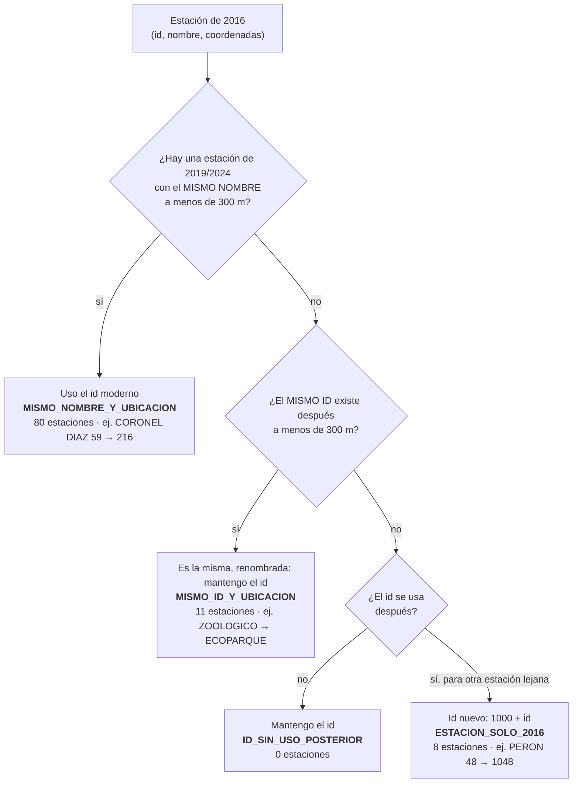
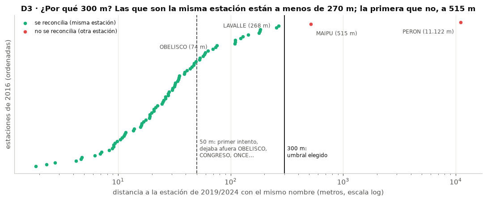
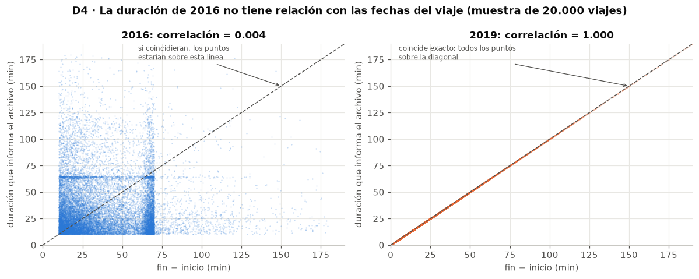
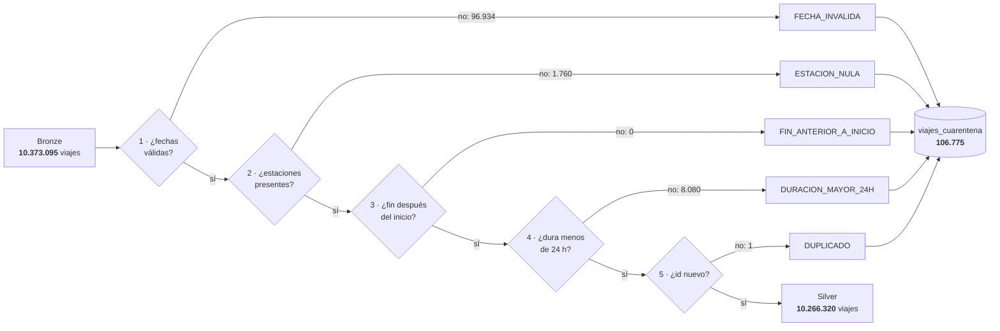

# Decisiones del pipeline

En este documento explico qué encontré en los archivos (Tarea 1), qué mapeos usa silver y, sobre todo, **cada
decisión que tomé y que no estaba indicada en el enunciado**, con su justificación.

**Cómo leerlo:** cada decisión tiene un número (**D1**, **D2**…) y un link 📍 a la parte del código donde está
implementada. En el código, el mismo número aparece en los comentarios como `(D3)`, así que se puede ir y
volver entre los dos. Todos los números salen de la última ejecución sobre los datos completos.

| | Decisión | Capa |
|---|---|---|
| [D1](#d1) | Bronze guarda el texto exacto, sin interpretar nulos | Bronze |
| [D2](#d2) | Id sintético para los viajes de 2016 | Silver |
| [D3](#d3) | **Reconciliación de ids de estación de 2016** | Silver |
| [D4](#d4) | **Duración de 2016 calculada de las fechas** | Silver |
| [D5](#d5) | Normalización de nombres de estación | Silver |
| [D6](#d6) | `""` y `"NA"` son nulos | Silver |
| [D7](#d7) | Regla de duplicados sobre los tres años juntos | Silver |
| [D8](#d8) | Columnas que descarto | Silver |
| [D9](#d9) | Reglas de calidad que evalué y no agregué | Silver |
| [D10](#d10) | Edades fuera de rango → nulo | Silver |
| [D11](#d11) | Ids de usuario repetidos entre años | Silver |
| [D12](#d12) | Cuarentena también para usuarios | Silver |
| [D13](#d13) | `dim_fecha` como calendario continuo | Gold |
| [D14](#d14) | Viajes cuyo usuario no está en `dim_usuario` | Gold |
| [D15](#d15) | Bordes de los rangos etarios | Gold |
| [D16](#d16)–[D18](#d18) | Detalles de los reportes 2, 3 y 5 | Reportes |
| [D19](#d19) | Cómo verifiqué la idempotencia | Todo |
| [D20](#d20) | Memoria y lectura sin `chunksize` | Todo |

---

## 0. Dos viajes reales a través de las tres capas

Antes de las tablas, un ejemplo concreto, como el de la sección 3.5 del enunciado pero con dos viajes **reales**
del dataset. Los elegí porque juntos muestran el problema más importante que encontré (D3): **el número 59 es
una estación distinta según el año**.

**Viaje 1 (2016):** de Coronel Díaz a Independencia, un domingo a la tarde.

| Campo | Bronze (como vino) | Silver (limpio y tipado) | Gold (con significado) |
|---|---|---|---|
| Id del viaje | *(no existe)* | `id_viaje`: `"2016-1274"` (D2) | `fact_viajes.id_viaje`: `"2016-1274"` |
| Inicio | `"2016-05-01 16:05:41"` (texto) | `2016-05-01 16:05:41` (datetime) | `fecha_key` 20160501 → **domingo**, fin de semana; `hora_inicio` 16 |
| Estación de origen | `"59"`, `"Coronel Díaz"` | `216`, `CORONEL DIAZ` (**59 → 216**, D3) | `dim_estacion` 216: CORONEL DIAZ, 2016 a 2024 |
| Estación de destino | `"18"`, `"Independencia"` | `59`, `INDEPENDENCIA` (**18 → 59**, D3) | `dim_estacion` 59: INDEPENDENCIA, 2016 a 2024 |
| Duración | `"0 days 00:27:40.000000000"` | `4166` s, calculada de las fechas (D4) | `duracion_min` 69.4 |
| Usuario | *(no existe)* | `<NA>` | `<NA>` |
| Origen | `_archivo_origen`: `recorridos-realizados-2016.zip` | `anio_fuente`: 2016 | cuenta en los reportes 1, 2 y 4 |

**Viaje 2 (2019):** de Independencia a Parque Las Heras, un miércoles.

| Campo | Bronze (como vino) | Silver (limpio y tipado) | Gold (con significado) |
|---|---|---|---|
| Id del viaje | `"7485BAEcobici"` | `"7485"` | `"7485"` |
| Inicio | `"2019-02-27 14:45:57"` | `2019-02-27 14:45:57` | `fecha_key` 20190227 → **miércoles**, laborable |
| Estación de origen | `"59BAEcobici"`, `"018 - Independencia"` | `59`, `INDEPENDENCIA` | `dim_estacion` 59: INDEPENDENCIA |
| Estación de destino | `"9BAEcobici"`, `"009 - Parque Las Heras"` | `9`, `PARQUE LAS HERAS` | `dim_estacion` 9: PARQUE LAS HERAS |
| Duración | `"2,324"` (¡con coma de miles!) | `2324` s | `duracion_min` 38.7 |
| Usuario | `"2176BAEcobici"` | `"2176"` | `dim_usuario`: M, 32 años, rango **26-35**, alta 2019 |

> En bronze, el viaje 1 **llega** a la estación `"18"` y el viaje 2 **sale** de la estación `"59BAEcobici"`. Son la
> misma estación física, Independencia. Y el `"59"` del viaje 1 es otra, Coronel Díaz. Sin la reconciliación de
> silver, gold habría mezclado las dos.

---

## 1. Exploración de los archivos (Tarea 1)

Abrí cada archivo con pandas leyendo las primeras 1000 filas ([`src/exploracion.py`](src/exploracion.py), se corre con `python -m src.exploracion`) y después revisé los datos completos con `value_counts()` y conversiones de prueba.
Estas tablas son la base de todo el mapeo de silver.

### Recorridos

| Aspecto | 2016 | 2019 | 2024 |
|---|---|---|---|
| Archivo dentro del ZIP | `recorridos-realizados-2016.csv` | `trips_2019.csv` | `badata_ecobici_recorridos_realizados_2024.csv` |
| Separador | `,` | `,` (todos los textos entre comillas) | `,` |
| Codificación | UTF-8 | UTF-8 | UTF-8 **con BOM** |
| Columnas | 15: `periodo, genero_usuario, fecha_origen_recorrido, id_estacion_origen, nombre_estacion_origen, long_estacion_origen, lat_estacion_origen, domicilio_estacion_origen, duracion_recorrido, fecha_destino_recorrido, id_estacion_destino, nombre_estacion_destino, long_estacion_destino, lat_estacion_destino, domicilio_estacion_destino` | 18: *(primera columna sin nombre, pandas la llama `Unnamed: 0`)*, `Id_recorrido, duracion_recorrido, fecha_origen_recorrido, id_estacion_origen, nombre_estacion_origen, direccion_estacion_origen, long_estacion_origen, lat_estacion_origen, fecha_destino_recorrido, id_estacion_destino, nombre_estacion_destino, direccion_estacion_destino, long_estacion_destino, lat_estacion_destino, id_usuario, modelo_bicicleta, género` | 17: `id_recorrido, duracion_recorrido, fecha_origen_recorrido, id_estacion_origen, nombre_estacion_origen, direccion_estacion_origen, long_estacion_origen, lat_estacion_origen, fecha_destino_recorrido, id_estacion_destino, nombre_estacion_destino, direccion_estacion_destino, long_estacion_destino, lat_estacion_destino, id_usuario, modelo_bicicleta, genero` |
| Formato de fecha y hora | `2016-01-01 02:21:41` (`%Y-%m-%d %H:%M:%S`) | igual | igual |
| ¿Trae duración? ¿Unidad? | Sí, como texto timedelta: `0 days 00:16:29.000000000`. **No coincide con fin − inicio** ([D4](#d4)) | Sí, en segundos, **con coma de miles**: `2,814` = 2814 s. Coincide al 100 % con fin − inicio | Sí, en segundos enteros. Coincide en el 99,9 % de los casos |
| ¿Trae id de usuario? | **No** | Sí, con sufijo: `6243BAEcobici` | Sí, como float: `992557.0` |
| Id de viaje | **No trae** | `9379BAEcobici` | `20428222` |
| Id de estación | número público de la estación ([D3](#d3)) | `5BAEcobici` (id interno) | `513` (id interno) |
| Nombre de estación | `Pacífico` (con tildes, sin prefijo) | `005 - Plaza Italia` | `308 - SAN MARTIN II` |
| Cantidad total de filas | **596.807** | **6.217.004** | **3.559.284** |
| Otras particularidades | 93.555 viajes sin fecha de destino (15,7 %). Trae género en el viaje | Coordenadas de destino corridas una columna. 1.760 viajes sin estación de destino. El año arranca el 9 de febrero | 3.379 viajes sin fecha de destino. 1 fila duplicada exacta |

### Usuarios

| Aspecto | 2016 | 2019 | 2024 |
|---|---|---|---|
| Archivo | `usuarios-ecobici-2016.csv` | `usuarios_ecobici_2019.csv` | `usuarios_ecobici_2024.csv` |
| Separador | `,` | `,` (textos entre comillas) | `,` |
| Codificación | UTF-8 | UTF-8 | UTF-8 **con BOM** |
| Columnas | `id_usuario, genero_usuario, edad_usuario, fecha_alta, hora_alta` | `ID_usuario` (**en mayúsculas**), `genero_usuario, edad_usuario, fecha_alta, hora_alta` | `id_usuario, genero_usuario, edad_usuario, fecha_alta, hora_alta` |
| Formato de fecha y hora | `01-01-16` + `3:45:19 AM` (**día-mes-año con año de 2 dígitos y reloj de 12 h**) | `2019-12-31` + `10:46:10` | `2024-01-18` + `09:21:02` |
| Valores de género | `M`, `F` | `MALE`, `FEMALE`, `OTHER`, vacío (857) | `MALE`, `FEMALE`, `OTHER` |
| Edad | 16 a 88 | texto `"NA"` en 765 filas; rango 0 a 935 | rango 4 a 2021 |
| Cantidad total de filas | **39.481** | **83.600** | **197.077** |

---

## 2. Mapeos (silver)

📍 Código: [`MAPEO_VIAJES`](src/silver.py#L65), [`MAPEO_USUARIOS`](src/silver.py#L77), [`FORMATO_ALTA`](src/silver.py#L86), [`MAPEO_GENERO`](src/silver.py#L91)

Puse todo lo que cambia entre años en diccionarios al principio de `silver.py`. Si mañana llega un año nuevo con
otro formato, alcanza con agregar una entrada; el resto del código no se toca.

### Viajes

| Canónica | 2016 | 2019 | 2024 |
|---|---|---|---|
| `id_viaje` | *(lo genero, [D2](#d2))* | `Id_recorrido` | `id_recorrido` |
| `fecha_hora_inicio` | `fecha_origen_recorrido` | `fecha_origen_recorrido` | `fecha_origen_recorrido` |
| `fecha_hora_fin` | `fecha_destino_recorrido` | `fecha_destino_recorrido` | `fecha_destino_recorrido` |
| `duracion_seg` | *(la calculo como fin − inicio, [D4](#d4))* | `duracion_recorrido` | `duracion_recorrido` |
| `id_estacion_origen` | `id_estacion_origen` *(reconciliado, [D3](#d3))* | `id_estacion_origen` | `id_estacion_origen` |
| `nombre_estacion_origen` | `nombre_estacion_origen` | `nombre_estacion_origen` | `nombre_estacion_origen` |
| `id_estacion_destino` | `id_estacion_destino` *(reconciliado, [D3](#d3))* | `id_estacion_destino` | `id_estacion_destino` |
| `nombre_estacion_destino` | `nombre_estacion_destino` | `nombre_estacion_destino` | `nombre_estacion_destino` |
| `id_usuario` | *(no existe: queda nulo)* | `id_usuario` | `id_usuario` |
| `anio_fuente` | *(constante 2016)* | *(constante 2019)* | *(constante 2024)* |

### Usuarios

| Canónica | 2016 | 2019 | 2024 |
|---|---|---|---|
| `id_usuario` | `id_usuario` | `ID_usuario` | `id_usuario` |
| `genero` | `genero_usuario` | `genero_usuario` | `genero_usuario` |
| `edad` | `edad_usuario` | `edad_usuario` | `edad_usuario` |
| `fecha_alta` | `fecha_alta` + `hora_alta` (`%d-%m-%y %I:%M:%S %p`) | `fecha_alta` + `hora_alta` (`%Y-%m-%d %H:%M:%S`) | igual que 2019 |

### Valores de género

| Valor original | Silver |
|---|---|
| `F`, `FEMALE`, `FEMENINO`, `MUJER` | `F` |
| `M`, `MALE`, `MASCULINO`, `HOMBRE` | `M` |
| `OTHER`, `OTRO`, `X`, `NO BINARIO` | `OTRO` |
| vacío, nulo, cualquier otro | `DESCONOCIDO` |

Antes de mapear aplico `strip()` y `upper()`, así que `Female` o ` female ` también caen en `F`. En los datos reales
solo aparecen `M`, `F`, `MALE`, `FEMALE`, `OTHER` y vacío. Agregué igual las variantes del enunciado para que el
pipeline no se rompa si un año futuro las trae.

---

## 3. Decisiones que tomé y no estaban en el enunciado

### Bronze

**D1. Bronze guarda el texto exacto, sin interpretar nulos.**
📍 [`leer_crudo()`](src/bronze.py#L31) · [`escribir_parquet()`](src/bronze.py#L55)

Aunque se use `dtype=str`, pandas convierte por defecto `""` y `"NA"` en NaN. Usé `keep_default_na=False` para
que bronze guarde exactamente el texto que vino. Decidir qué es nulo es trabajo de silver ([D6](#d6)).

- Leo con `encoding="utf-8-sig"`. El BOM de 2024 es un artefacto de codificación, no un dato: sin esto, la primera columna se llamaría `id_recorrido`.
- La columna sin nombre de 2019 queda como `Unnamed: 0`, que es como pandas nombra un encabezado vacío. Es un índice de fila del sistema origen y silver la descarta.
- Abro el ZIP con `zipfile` y tomo el único `.csv` que contiene. Si hubiera más de uno, el pipeline falla con un mensaje claro en lugar de adivinar.
- **Escritura atómica:** cada Parquet se escribe a un `.tmp` y después se renombra. Si el proceso se corta, nunca queda una tabla a medio escribir (es una de las cosas que aportaría Delta Lake o Iceberg, sección 3.6).

### Silver: viajes

**D2. Id sintético para los viajes de 2016: `"2016-<número de fila>"`.**
📍 [`preparar_viajes()`, rama sin id](src/silver.py#L282)

El archivo no trae id. Lo genero en el orden del archivo, que es fijo, así que el id es determinístico y el pipeline
sigue siendo idempotente. Antes verifiqué que 2016 no tiene filas duplicadas exactas, así que no pierdo ningún control de duplicados.
En 2019 quito el sufijo `BAEcobici`. Verifiqué que los ids resultantes (10 a 6.875.895) no chocan con los de 2024 (20.180.969 a 24.503.283).

**D3. Reconciliación de los ids de estación de 2016.** *Fue el problema más importante del trabajo.*
📍 [`reconciliar_estaciones_2016()`](src/silver.py#L206) · [`DIST_MAX_RECONCILIACION_M`](src/silver.py#L108) · [donde se aplica](src/silver.py#L265)

En 2016 el id de estación es el **número público**, el mismo que aparece como prefijo en `059 - Coronel Diaz`.
Desde 2019 el id es **interno** y es otro número. Si usaba el id tal cual, el id 59 sería "Coronel Díaz" en 2016 e
"Independencia" en 2019/2024 (ver la [sección 0](#0-dos-viajes-reales-a-través-de-las-tres-capas)), y dim_estacion,
que toma el nombre más reciente, le pondría a los viajes de 2016 el nombre de otra estación.

Lo resolví en silver porque es limpieza de datos: gold no tiene que enterarse de este problema. Para cada estación
de 2016 pruebo estos criterios en orden, del más fuerte al más débil:

**¿Por qué 300 m?** Las coordenadas de 2016 están corridas respecto de las de 2019/2024. Primero probé con 50 m y
quedaban afuera estaciones obvias como OBELISCO, CONGRESO y ONCE. Graficando la distancia de cada estación de 2016 a
la estación moderna con el mismo nombre, todas las que son la misma están a menos de 270 m (LAVALLE es la más lejana)
y la primera que no es la misma está a 515 m (MAIPU). 300 m, unas tres cuadras, queda en el medio:

**¿Por qué no alcanza con las coordenadas?** Porque la estación más cercana no siempre es la misma: ONCE (2016) está a
17 m de ONCE II, que es otra estación. Por eso pido nombre **y** ubicación.

**¿Por qué `1000 + id`?** Es un rango que no usa ningún id real (el máximo es de 3 cifras), y se lee fácil: 1048 es
"la 48 de 2016". El 1000 no está escrito a mano: el código calcula la potencia de 10 siguiente al id más grande ([L227](src/silver.py#L227)).

Uso solo las coordenadas de **origen**, porque las de destino de 2019 vienen corridas una columna.

Casos no triviales de la reconciliación:

| id 2016 | Nombre 2016 | id silver | Nombre actual | Criterio |
|---|---|---|---|---|
| 18 | INDEPENDENCIA | 59 | INDEPENDENCIA | mismo nombre |
| 59 | CORONEL DIAZ | 216 | CORONEL DIAZ | mismo nombre |
| 1 | FACULTAD DE DERECHO | 202 | FACULTAD DE DERECHO | mismo nombre |
| 16 | LEGISLATURA | 441 | LEGISLATURA | mismo nombre |
| 19 | PLAZA SAN MARTIN | 536 | PLAZA SAN MARTIN | mismo nombre |
| 61 | MINISTERIO DE ECONOMIA | 444 | MINISTERIO DE ECONOMIA | mismo nombre |
| 97 | AVELINO DIAZ | 220 | AVELINO DIAZ | mismo nombre |
| 67 | SENILLOSA | 218 | SENILLOSA | mismo nombre |
| 44 | ZOOLOGICO | 44 | ECOPARQUE | mismo id (renombrada) |
| 2 | RETIRO | 2 | RETIRO I | mismo id |
| 26 | JUANA MANSO | 26 | JUANA MANSO I | mismo id |
| 49 | TREINTA Y TRES ORIENTALES | 49 | 33 ORIENTALES | mismo id |
| 114 | DELLA PAOLERA | 114 | TORRE MACRO | mismo id |
| 81 | BALCARCE | 81 | EX BALCARCE | mismo id |
| 47 | COLEGIO NACIONAL BUENOS AIRES | 47 | COLEGIO NACIONAL DE BUENOS AIRES | mismo id |
| 166 | CEMENTERIO DE LA RECOLETA | 166 | CEMENTERIO DE RECOLETA | mismo id |
| 41 | URQUIZA | 41 | PARQUE PATRICIOS II | mismo id |
| 10 | PUERTO MADERO - UCA | 10 | *(en 2019 figura como `KP1808000368`, [D5](#d5))* | mismo id |
| 37 | PIEDRAS | 37 | *(en 2019 figura como `off braudacco`, [D5](#d5))* | mismo id |
| 34, 36, 48, 68, 77, 80, 98, 150 | GALERIAS PACIFICO, MAIPU, PERON, RIVAROLA, SARANDI, DOBLAS, MORENO, VERA PENALOZA | 1034, 1036, … | (igual) | solo 2016 |

La tabla completa (99 filas) se genera en cada corrida en `data/silver/mapeo_estaciones_2016.csv`, para poder auditarla.

**D4. Duración de 2016 calculada como fin − inicio.**
📍 [`preparar_viajes()`, rama de la duración](src/silver.py#L270)

Cuando comparé el campo de duración de 2016 (`0 days 00:16:29`) con las fechas del mismo viaje, vi que **no tienen
ninguna relación**: la correlación es 0,002. Los dos valores se reparten entre 10 y 180 minutos, y los segundos del
campo están distribuidos de forma perfectamente uniforme. Eso sugiere que los datos de 2016 fueron anonimizados o
perturbados por la fuente. En 2019 coinciden exactamente:

Decidí calcularla de las fechas porque el enunciado lo pide cuando la duración viene "en otra unidad", y porque así
`duracion_seg` queda coherente con `fecha_hora_inicio` y `fecha_hora_fin`, que son las que usan las reglas 3 y 4.
Para 2019 y 2024 uso el campo de la fuente, que coincide con fin − inicio (100 % y 99,9 %).
Consecuencia: los 93.555 viajes de 2016 sin fecha de fin quedan sin duración y van a cuarentena por `FECHA_INVALIDA`.

**D5. Normalización de nombres de estación.**
📍 [`normalizar_nombre()`](src/silver.py#L144) · [`NOMBRES_PLACEHOLDER`](src/silver.py#L103) · [nombre en dim_estacion](src/gold.py#L46)

Además de lo que pide el enunciado (`strip`, mayúsculas, espacios múltiples), agregué tres pasos:
- **Quito el prefijo numérico** (`005 - Plaza Italia` → `PLAZA ITALIA`; también formatos como `131- HOSPITAL` o `048 -PERON`). Sin esto, el mismo nombre de 2016 y de 2024 nunca quedaba igual. El número ya no aporta nada: la clave es el id.
- **Quito las tildes** (`Pacífico` → `PACIFICO`): en 2016 vienen con tilde y en 2024 sin tilde.
- **Paso a nulo los nombres provisorios:** `KP1808000368`, `ERRONEA`, `PLANEADA`, `OFF BRAUDACCO` y `TEST TECNICO PDM` aparecen en 2019 como nombre de estación, pero son placeholders del sistema. Lo descubrí porque en la primera versión del top 10 de 2016 aparecía "KP1808000368" en el puesto 8, en lugar de Puerto Madero UCA. Los viajes se conservan (20.436), solo pierden el nombre. dim_estacion toma el nombre válido más reciente; los ids 1 y 178, que solo tienen placeholders, quedan como `SIN NOMBRE`.

**D6. `""` y `"NA"` son nulos.**
📍 [`VALORES_NULOS`](src/silver.py#L99) · [donde se aplica](src/silver.py#L255)

Al pasar a silver, convierto en nulo el texto vacío (así lo guarda bronze, [D1](#d1)) y el literal `"NA"` (las edades de 2019) antes de tipar.

**D7. La regla de duplicados se aplica a los tres años juntos.**
📍 [`aplicar_calidad()`](src/silver.py#L293) · [por qué juntos](src/silver.py#L375)

`DUPLICADO` se evalúa con `duplicated(keep="first")` sobre los tres años concatenados, en orden 2016 → 2019 → 2024 y
en el orden de cada archivo. Así también detectaría un id repetido entre años distintos. Solo hay un caso: el viaje
22425357 de 2024, que aparece dos veces idéntico.

Así queda el embudo de calidad con los datos reales (cada fila se queda con el **primer** motivo que falla):

**D8. Columnas que descarto.**
📍 [`MAPEO_VIAJES`](src/silver.py#L65)

Coordenadas, direcciones, modelo de bicicleta, `periodo` y el género que traen los archivos de viajes. No están en el
esquema canónico, y el género se toma de la tabla de usuarios, como define el esquema. Siguen disponibles en bronze si alguna vez hacen falta.

**D9. Reglas de calidad que evalué y no agregué.**
- 37.618 viajes de 2024 duran 0 segundos, probablemente retiros cancelados. No violan ninguna regla del enunciado, así que se conservan. Sería una buena regla futura (`DURACION_CERO`).
- Algunos nombres traen marcas como `-- CDO CHACARITA -- (TEMPORAL)`. Los dejé tal cual.

### Silver: usuarios

**D10. Edades fuera de [16, 90] → nulo** (lo pide el enunciado).
📍 [`preparar_usuarios()`](src/silver.py#L332)

Afectó a 140 registros, más las 765 edades `"NA"` de 2019. No rechazo al usuario, porque su género y su fecha de alta siguen siendo datos válidos.

**D11. Ids de usuario repetidos entre años.**
📍 [`calidad_usuarios()`](src/silver.py#L339)

5.231 ids aparecen en el archivo de 2016 y en el de 2019. Como dice el enunciado, me quedo con el de `fecha_alta` más
reciente (el de 2019). Pero revisé esos casos y hay evidencia de que **no son la misma persona**: el género coincide
solo en el 39 % de los casos y las edades no tienen relación. Probablemente el sistema nuevo de 2019 reutilizó ids.
Con estos datos no se puede resolver, así que aplico la regla y lo dejo documentado.

**D12. Cuarentena también para usuarios** (`silver/usuarios_cuarentena`).
📍 [`calidad_usuarios()`](src/silver.py#L339)

El enunciado solo la pide para viajes, pero el principio de no perder registros vale igual. Así también puedo
conciliar: 320.158 en bronze = 314.927 válidos + 5.231 duplicados.

### Gold

**D13. `dim_fecha` es un calendario continuo.**
📍 [`construir_dim_fecha()`](src/gold.py#L26)

Va del 2016-01-01 al 2024-12-31 (3.288 días), incluidos 2017, 2018 y 2020 a 2023, que no tienen viajes. Es la
práctica estándar en un data warehouse: un día sin viajes también existe y debe poder contarse como 0.

**D14. Viajes con `id_usuario` que no está en dim_usuario: 6.120.635 de 9.763.068 viajes con usuario (62,7 %).**
📍 [`gold.ejecutar()`](src/gold.py#L103)

Por año: 2019 tiene 4.410.500 (71 %) y 2024 tiene 1.710.135 (48 %). Además, los 503.252 viajes válidos de 2016 no traen id de usuario.

**Mi explicación:** cada archivo de usuarios contiene solo las **altas de ese año**. Un usuario que se registró en 2015,
2017, 2018 o entre 2020 y 2023 viaja, pero no está en ningún archivo. Cuadra con los datos: en 2024 el 32 % de los
viajes es de usuarios dados de alta en 2024, y otro 20 % de usuarios de los archivos de 2016 y 2019.
No creo filas "desconocido" en dim_usuario: el enunciado acepta que la clave sea nula o no tenga par.

**D15. Rangos etarios:** 16-25, 26-35, 36-50, 51+ (bordes incluidos). Una edad nula da `DESCONOCIDO`.
📍 [`rango_etario()`](src/gold.py#L71)

### Reportes

**D16. Reporte 2:** desempato por `id_estacion` ascendente, para que el ranking sea igual en todas las corridas. Agregué la columna `id_estacion` además del nombre.
📍 [`top10_estaciones_por_anio()`](src/reportes.py#L23)

**D17. Reporte 3:** uso un *inner join* con dim_usuario, así que solo cuentan los 3.642.433 viajes cuyo usuario se
conoce. Un viaje sin usuario no tiene ni edad ni género, y meterlo como `DESCONOCIDO` mezclaría dos cosas distintas.
Por eso 2016 no aparece.
📍 [`duracion_por_rango_y_genero()`](src/reportes.py#L38)

**D18. Reporte 5:** además de las columnas pedidas, agregué una columna por motivo de cuarentena
(`cuarentena_fecha_invalida`, etc.). El porcentaje dice *cuánto* se rechazó; el desglose dice *por qué*.
📍 [`calidad_por_anio()`](src/reportes.py#L61)

### Ejecución

**D19. Cómo verifiqué la idempotencia.**
📍 [`verificar.py`: `huella()` e `idempotencia()`](verificar.py#L90)

`python verificar.py --idempotencia` corre el pipeline dos veces y compara un hash del contenido de todas las tablas
y reportes. La única columna que excluyo es `_fecha_ingesta`, que por diseño cambia en cada corrida. El mismo método
me sirvió para comprobar que agregar comentarios al código no cambió ni un dato.

**D20. Memoria: leo cada año completo, sin `chunksize`.**

El pico fue de unos 4,3 GB de RAM. Silver le pide a bronze solo las columnas que necesita ([L253](src/silver.py#L253)),
aprovechando que Parquet es columnar. Si hiciera falta correrlo en una máquina con menos memoria, el siguiente paso
sería leer bronze por partes con `chunksize`.
