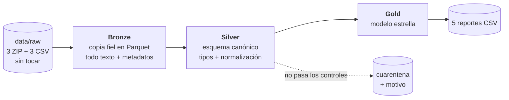
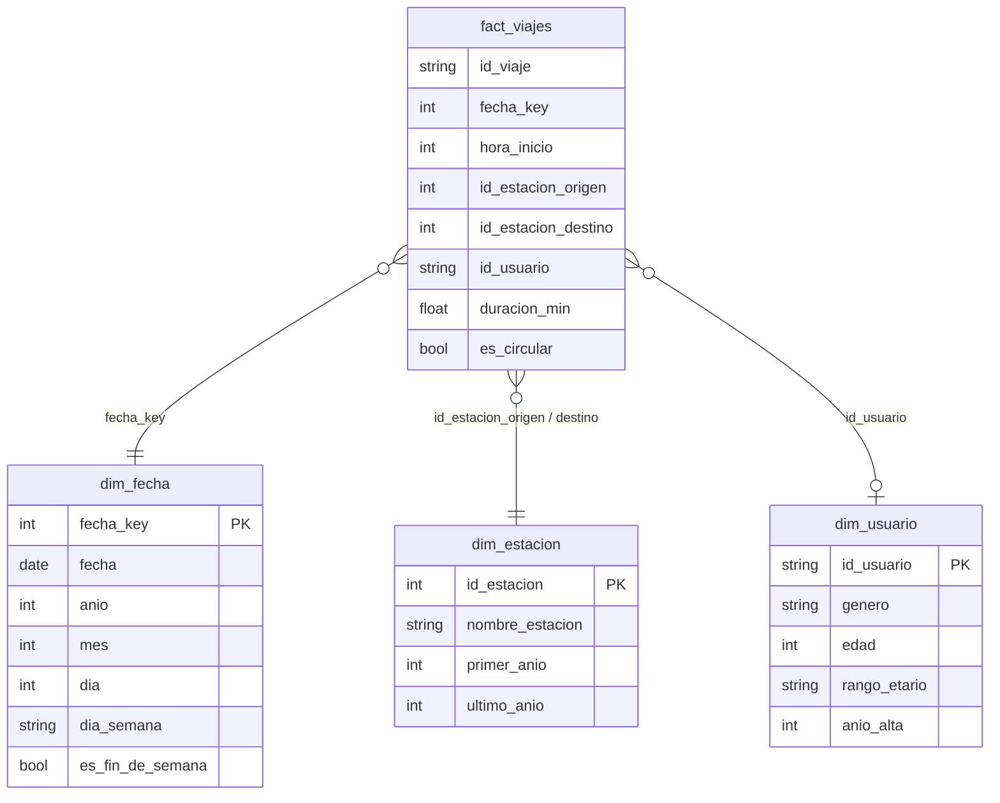
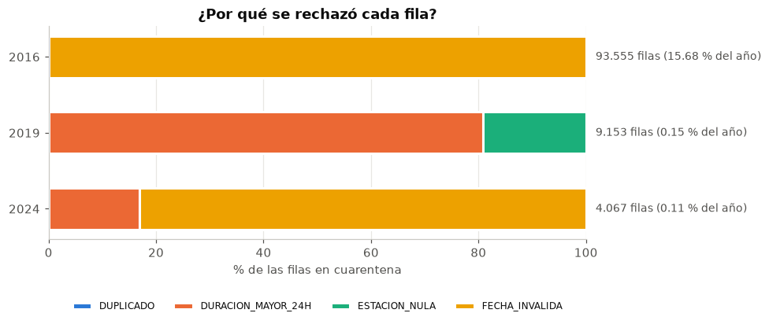
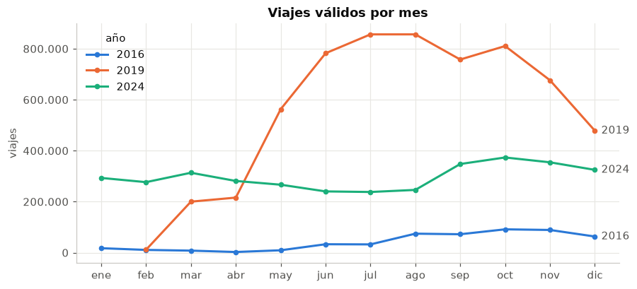
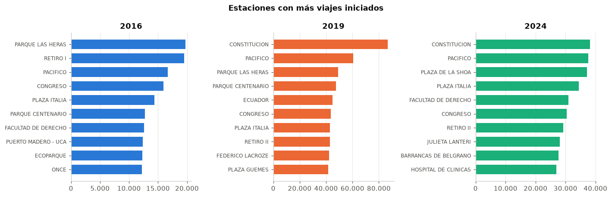
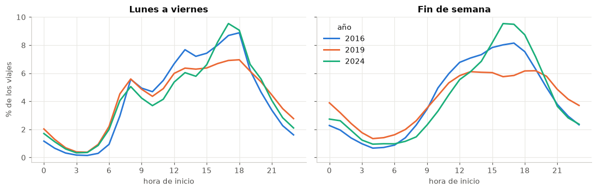
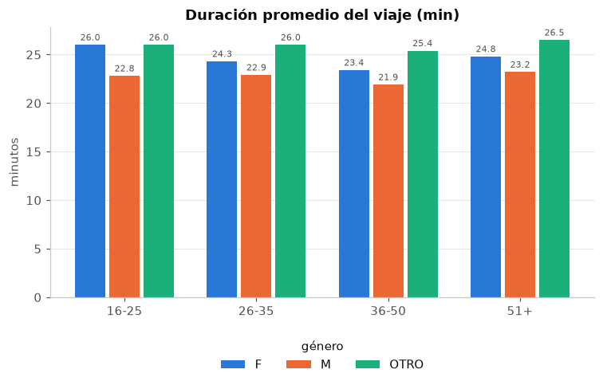

# Pipeline Ecobici: Bronze, Silver y Gold

Pipeline de datos en **Python y pandas** que toma los archivos públicos de viajes de Ecobici (Ciudad de Buenos Aires)
de **2016, 2019 y 2024**, tal como los publica el portal de datos abiertos, y los lleva por una arquitectura
**medallion** hasta un modelo estrella y cinco reportes.

> Trabajo práctico de *Ciencia de Datos*, Ingeniería en Sistemas de Información.

- **10,37 millones de viajes** procesados; ningún registro se pierde: lo que no pasa los controles queda en cuarentena con su motivo.
- **Un solo comando** (`python main.py`) corre todo de punta a punta en unos 3 minutos y es **idempotente**.
- **27 verificaciones automáticas** (`python verificar.py`): conciliación, esquema, unicidad, integridad referencial e idempotencia.
- Cada decisión que no estaba en el enunciado está justificada en **[DECISIONES.md](DECISIONES.md)**.

---

## Arquitectura



| Capa | Código | Responde | Salida |
|---|---|---|---|
| Bronze | [`src/bronze.py`](src/bronze.py) | ¿Qué llegó? | `data/bronze/{recorridos,usuarios}/anio=AAAA/data.parquet` |
| Silver | [`src/silver.py`](src/silver.py) | ¿Qué pasó realmente? | `data/silver/{viajes, viajes_cuarentena, usuarios, usuarios_cuarentena}/` |
| Gold | [`src/gold.py`](src/gold.py) | ¿Qué significa para el negocio? | `data/gold/{fact_viajes, dim_fecha, dim_estacion, dim_usuario}/` |
| Reportes | [`src/reportes.py`](src/reportes.py) | Las 5 preguntas del enunciado | [`data/gold/reportes/*.csv`](data/gold/reportes) |

### Modelo estrella (gold)



---

## Hallazgos sobre los datos

Los tres años **no comparten formato**. Estos son los problemas que tuvo que resolver silver (detalle en [DECISIONES.md](DECISIONES.md)):

| Problema | Dónde | Cómo se resolvió |
|---|---|---|
| **Los ids de estación cambian de significado.** En 2016 el id es el número público y desde 2019 es un id interno: el id 59 es "Coronel Díaz" en 2016 e "Independencia" después | 2016 vs 2019/2024 | Reconciliación por nombre + distancia (≤ 300 m), con una tabla de equivalencias auditable ([D3](DECISIONES.md#silver-viajes)) |
| **La duración de 2016 no coincide con sus fechas** (correlación 0,002) | 2016 | Se recalcula como fin − inicio ([D4](DECISIONES.md#silver-viajes)) |
| Duración con coma de miles: `"2,814"` | 2019 | Se limpia antes de convertir a número |
| Ids con sufijo (`6243BAEcobici`) o como float (`992557.0`) | 2019 / 2024 | Se normalizan a texto limpio |
| Nombres con prefijo, tildes y espacios dobles (`"019 - PLAZA  SAN MARTIN"`, `"Pacífico"`) | todos | Una sola normalización ([D5](DECISIONES.md#silver-viajes)) |
| Nombres provisorios de estación (`KP1808000368`, `ERRONEA`) | 2019 | Pasan a nulo; dim_estacion usa el último nombre válido |
| Fechas de alta con año de 2 dígitos y reloj de 12 h (`01-01-16 3:45:19 AM`) | usuarios 2016 | Un formato de fecha por año |
| Coordenadas de destino corridas una columna | 2019 | No se usan para reconciliar |
| BOM UTF-8 en el encabezado | 2024 | Se lee con `utf-8-sig` |
| 15,7 % de los viajes sin fecha de devolución | 2016 | Cuarentena `FECHA_INVALIDA` |

### Calidad por año

| Año | Bronze | Silver | Cuarentena | % |
|---|---:|---:|---:|---:|
| 2016 | 596.807 | 503.252 | 93.555 | 15,68 |
| 2019 | 6.217.004 | 6.207.851 | 9.153 | 0,15 |
| 2024 | 3.559.284 | 3.555.217 | 4.067 | 0,11 |



---

## Resultados

El análisis completo, con conclusiones y consultas SQL con DuckDB, está en **[informe.ipynb](informe.ipynb)**.









---

## Cómo ejecutarlo

### Requisitos

- Python 3.12 o superior (probado con 3.12.13)
- pandas ≥ 2.2 y pyarrow ≥ 15 (probado con pandas 3.1 y pyarrow 26)
- unos 5 GB de RAM libres y 1 GB de disco para las capas generadas

```bash
git clone https://github.com/alva-p/ecobici-pipeline.git
cd ecobici-pipeline
python -m venv .venv
source .venv/bin/activate          # en Windows: .venv\Scripts\activate
pip install -r requirements.txt
```

### Datos de entrada

Descargá de <https://data.buenosaires.gob.ar/dataset/bicicletas-publicas> estos 6 archivos y copialos **sin descomprimir ni modificar** en `data/raw/`:

```
data/raw/
├── recorridos-realizados-2016.zip
├── recorridos-realizados-2019.zip
├── recorridos-realizados-2024.zip
├── usuarios-ecobici-2016.csv
├── usuarios_ecobici_2019.csv
└── usuarios_ecobici_2024.csv
```

Si falta alguno, `main.py` lo avisa y no arranca. Los datos no están en el repo porque pesan unos 600 MB.

### Ejecución

```bash
python main.py                        # pipeline completo, de raw a reportes (~3 min)
python verificar.py                   # 26 verificaciones sobre reglas y salidas
python verificar.py --idempotencia    # + corre el pipeline 2 veces y compara (27 en total)
jupyter notebook informe.ipynb        # informe con gráficos y SQL sobre gold
```

### Qué se verifica

Si alguno de estos controles falla, el pipeline corta **antes de escribir** la capa:

- Conciliación por año: filas de bronze = filas de silver + filas de cuarentena.
- `id_viaje` único en silver; `id_usuario` único en silver/usuarios.
- `validar_esquema()`: columnas y tipos idénticos al esquema canónico.
- `fact_viajes` tiene una fila por viaje de silver; toda `fecha_key` existe en `dim_fecha` y toda estación existe en `dim_estacion`.

---

## Estructura

```
ecobici-pipeline/
├── data/
│   ├── raw/                  ← archivos descargados (no se versionan)
│   ├── bronze/ silver/ gold/ ← se regeneran con main.py (no se versionan)
│   └── gold/reportes/        ← los 5 reportes CSV
├── src/
│   ├── config.py             ← rutas y años
│   ├── bronze.py
│   ├── silver.py             ← mapeos por año, normalización, reglas de calidad
│   ├── gold.py
│   └── reportes.py
├── docs/img/                 ← gráficos del informe
├── main.py
├── verificar.py
├── informe.ipynb
├── DECISIONES.md
├── README.md
└── requirements.txt
```
